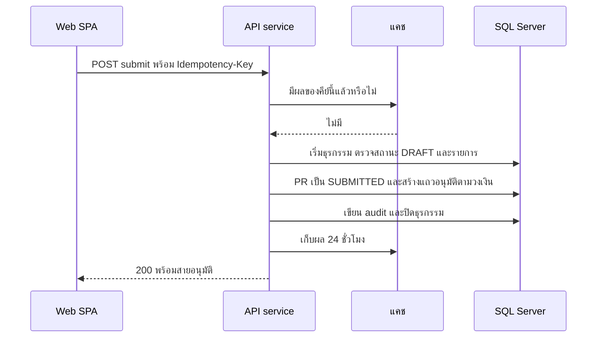

# ส่งใบขอซื้อเพื่ออนุมัติ

<!-- table: ลำดับและผลของการส่งใบขอซื้อ -->
| ลำดับ | การทำงานภายใน | ผลลัพธ์หรือข้อผิดพลาด |
|---|---|---|
| 1 | ค้นแคชด้วย `Idempotency-Key` ของผู้เรียก | คีย์เดิม payload เดิมตอบผลเดิมทันทีโดยไม่ทำซ้ำ; ไม่มีหัวนี้ `422` `ERR-VAL-001`; คีย์เดิม payload ต่าง `422` `ERR-IDEM-001` |
| 2 | เริ่มธุรกรรม อ่าน PR และล็อกแถว PR ต้องเป็นของผู้เรียก | ไม่ใช่ของตนหรือไม่พบ `404` `ERR-NF-001` |
| 3 | สถานะต้องเป็น `DRAFT` (BR-12) และมีรายการอย่างน้อยหนึ่งรายการ | สถานะอื่น `409` `ERR-STATE-001` |
| 4 | สร้างแถว `approval` ชนิด `PR` ตามวงเงินรวม (BR-03): ไม่เกิน 20,000.00 ขั้น `DEPT_APPROVER`; เกิน 20,000.00 ถึง 200,000.00 เพิ่ม `PROCUREMENT_HEAD`; เกิน 200,000.00 เพิ่ม `COMMITTEE` เรียง `step_no` ตั้งแต่ 1 ทุกแถว `PENDING` | วงเงินที่ขอบช่วงอยู่ในช่วงล่าง (20,000.00 ได้ 1 ขั้น 20,000.01 ได้ 2 ขั้น) |
| 5 | ตั้ง PR เป็น `SUBMITTED` บันทึก `submitted_at` และ `row_version` ใหม่ เขียน `audit_log` (`SUBMIT`) แล้วปิดธุรกรรม | |
| 6 | เก็บผลในแคช 24 ชั่วโมง ตอบ `200` พร้อมสายอนุมัติ | แคชถูกล้างแล้วส่งซ้ำด้วยคีย์เดิม: ด่านสถานะในลำดับที่ 3 กันการสร้างซ้ำ ตอบ `409` `ERR-STATE-001` และไม่สร้างแถวอนุมัติหรือ audit เพิ่ม |
