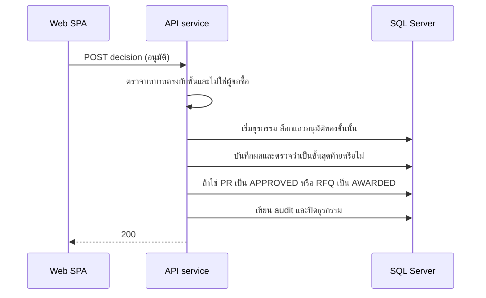

# อนุมัติขั้นสุดท้าย

<!-- table: ลำดับและผลของการตัดสินการอนุมัติ -->
| ลำดับ | การทำงานภายใน | ผลลัพธ์หรือข้อผิดพลาด |
|---|---|---|
| 1 | หาแถว `approval` ตาม `approvalId`; ผู้อนุมัติหน่วยงานเห็นเฉพาะแถวของ PR ในหน่วยงานตน บทบาทอื่นเห็นทุกหน่วยงาน | ไม่พบหรืออยู่นอกขอบเขต `404` `ERR-NF-001` |
| 2 | บทบาทใน claim ต้องมี `required_role` ของแถวนี้ | ไม่มี `403` `ERR-AUTH-002` |
| 3 | แยกหน้าที่ (BR-04): ผู้เรียกต้องไม่ใช่ผู้ขอซื้อของ PR (ชนิด `PR`) หรือผู้เสนอผล `awarded_by` (ชนิด `AWARD`) เทียบรหัสผู้ใช้ | `403` `ERR-SOD-001` |
| 4 | ตรวจ body: `decision` เป็น `APPROVED` หรือ `REJECTED`; `REJECTED` ต้องมี `comment` | `422` `ERR-VAL-001` |
| 5 | เริ่มธุรกรรม ล็อกแถวอนุมัติ แถวต้อง `PENDING` และเป็นขั้นต่ำสุดที่ยังรออยู่ของเอกสาร (ตัดสินข้ามขั้นไม่ได้) | ไม่ตรง `409` `ERR-STATE-001` |
| 6 | บันทึก `decision` `comment` `decided_at` และเขียน `audit_log` (`APPROVE` หรือ `REJECT`; `entity` เป็น `PR` หรือ `RFQ`) | |
| 7 | ถ้าปฏิเสธ: ลบแถว `approval` ทั้งชุดของเอกสารนั้น PR กลับ `DRAFT` (แก้ไขได้ และส่งใหม่จะสร้างสายอนุมัติใหม่) หรือ RFQ กลับ `OPEN` พร้อมลบแถว `award`; เหตุผลอยู่ใน `audit_log` | ประวัติอยู่ที่ `audit_log` ไม่เก็บแถวอนุมัติเก่า |
| 8 | ถ้าอนุมัติและไม่มีแถว `PENDING` เหลือ: PR เป็น `APPROVED` หรือ RFQ เป็น `AWARDED` (BR-05) | `200` พร้อมแถวที่ตัดสิน |
