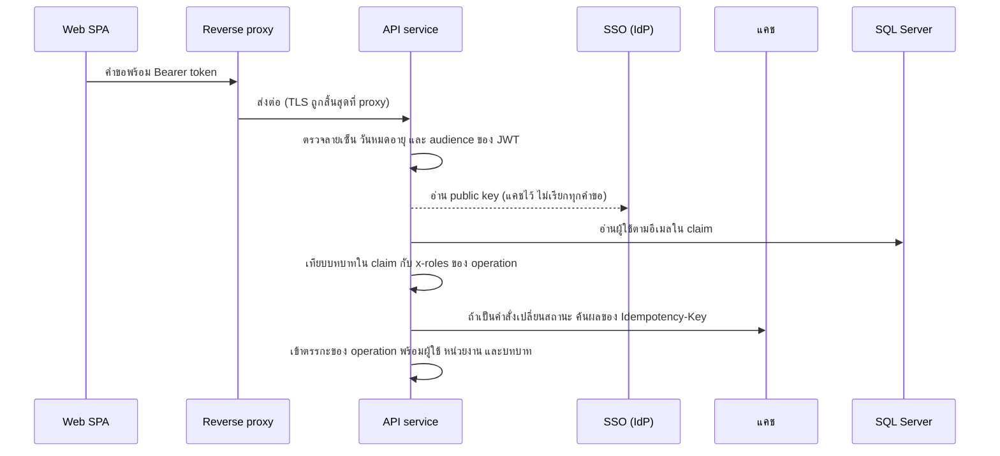

# ตรวจสิทธิ์ก่อนเข้า operation

ทุก operation ผ่านลำดับนี้ก่อนถึงตรรกะของตนเอง ตรวจเรียงจากถูกไปแพง และหยุดที่ขั้นแรกที่ไม่ผ่าน

<!-- table: ผู้ร่วมใน runtime ของการตรวจสิทธิ์ -->
| ผู้ร่วม | หน้าที่ในลำดับนี้ |
|---|---|
| Reverse proxy | สิ้นสุด TLS ส่งหัว `Authorization` ต่อให้ API ไม่ตรวจเนื้อหา token |
| API service | ตรวจ token อ่านผู้ใช้ ตรวจบทบาทและขอบเขต ตัดสินว่าเข้าตรรกะได้หรือไม่ |
| SSO (IdP) | ออก JWT และเผยแพร่ public key; ไม่ถูกเรียกทุกคำขอ |
| แคช | เก็บผลของ `Idempotency-Key` 24 ชั่วโมง |
| SQL Server | เก็บผู้ใช้ (`app_user`) ใช้ตรวจสถานะใช้งานและหน่วยงาน |

<!-- table: ลำดับและผลของการตรวจสิทธิ์ -->
| ลำดับ | ตรวจอะไร | ไม่ผ่านแล้ว | หมายเหตุ |
|---|---|---|---|
| 1 | มี `Authorization: Bearer` และ JWT ลายเซ็น วันหมดอายุ audience ถูกต้อง | `401` `ERR-AUTH-001` | ใช้ public key ที่แคชไว้ ถ้าไม่พบ `kid` จึงอ่านใหม่หนึ่งครั้ง |
| 2 | ผู้ใช้ตามอีเมลใน claim มีอยู่ใน `app_user` และ `is_active` เป็นจริง | `403` `ERR-AUTH-002` | ผู้ใช้ที่ SSO รู้จักแต่ยังไม่ถูกเพิ่มในระบบ เข้าใช้ไม่ได้ |
| 3 | บทบาทใน claim อยู่ใน `x-roles` ของ operation | `403` `ERR-AUTH-002` | บทบาทมาจาก claim ไม่รับจาก body |
| 4 | ขอบเขตข้อมูล: ผู้ขอซื้อเห็นเฉพาะ PR ของตน ผู้อนุมัติหน่วยงานเห็น PR ของหน่วยงานตน บทบาทอื่นที่เรียก operation นั้นได้เห็นทุกหน่วยงาน | PR ที่อยู่นอกขอบเขตตอบ `404` `ERR-NF-001` (ไม่บอกว่ามีอยู่) | ใช้เงื่อนไขในคำสั่งอ่านฐานข้อมูล ไม่กรองหลังอ่านใน memory |
| 5 | คำสั่งเปลี่ยนสถานะ: `Idempotency-Key` ตรงกับที่เคยเห็นหรือไม่ | คีย์เดิม payload ต่าง `422` `ERR-IDEM-001`; คีย์เดิม payload เดิมตอบผลเดิมโดยไม่ทำซ้ำ | ใช้ร่วมทุก operation ที่รับคีย์ |
| 6 | ตรวจ BR-04 (แยกหน้าที่) เฉพาะ operation อนุมัติ | `403` `ERR-SOD-001` | ตรวจใน service ของการอนุมัติ ดู V-04 |

ผู้ใช้และบทบาทที่ผ่านการตรวจถูกส่งต่อให้ตรรกะของ operation เป็นค่าเดียว ทุก operation อ่านผู้ใช้จากค่านี้ ไม่อ่านซ้ำจาก token
