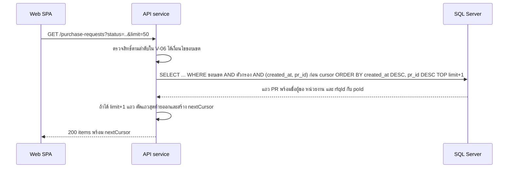

# อ่านใบขอซื้อและกล่องอนุมัติ

<!-- table: ลำดับการทำงานของการอ่านใบขอซื้อ -->
| ลำดับ | operation | การทำงานภายใน | ผลลัพธ์หรือข้อผิดพลาด |
|---|---|---|---|
| 1 | `listPurchaseRequests` | ใส่เงื่อนไขขอบเขตตามบทบาทในคำสั่ง SQL แล้วกรองด้วย `status`, `createdFrom`, `createdTo`, `requesterId` | แถวเรียงใหม่สุดก่อน ใช้ดัชนี `ix_pr_status_created` และ `ix_pr_requester` (NFR-01) |
| 2 | `listPurchaseRequests` | อ่านเกินหนึ่งแถว (`limit` + 1) เพื่อรู้ว่ามีหน้าถัดไป `nextCursor` คือ (`created_at`, `pr_id`) ของแถวสุดท้ายที่ส่งออก เข้ารหัส base64 | `nextCursor` เป็น null เมื่อไม่มีหน้าถัดไป |
| 3 | `listPurchaseRequests` | `rfqId` คือ RFQ ล่าสุดของ PR และ `poId` คือ PO ที่ไม่ถูกยกเลิกของ PR | ใช้นำทางจากหน้ารายการ ค่าว่างเมื่อยังไม่มี |
| 4 | `getPurchaseRequest` | อ่าน PR พร้อมรายการ (`pr_item` เรียงตาม `line_no`) และแถวอนุมัติของ PR (`approval` ที่ `doc_type` เป็น `PR` เรียงตาม `step_no`) ภายใต้เงื่อนไขขอบเขตเดียวกัน | `404` `ERR-NF-001` เมื่อไม่พบหรืออยู่นอกขอบเขต; `rowVersion` ส่งเป็นสตริงฐานสิบหก |
| 5 | `listMyApprovals` | อ่านแถว `approval` ที่ `decision` เป็น `PENDING` และ `step_no` เป็นขั้นต่ำสุดที่ยังรออยู่ของเอกสาร และ `required_role` ตรงบทบาทผู้เรียก ใช้ดัชนี `ix_approval_pending` แล้วเติมเลขที่ หัวข้อ ผู้ขอ วงเงิน จากเอกสารต้นทางตาม `doc_type` | เรียงเก่าสุดก่อน; `proposerId` คือผู้ขอซื้อ (PR) หรือผู้เสนอผล (AWARD) เพื่อให้หน้าซ่อนปุ่มตาม BR-04 |
