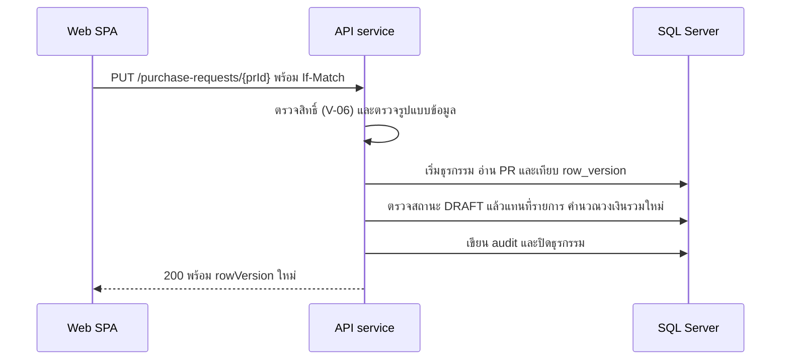

# สร้างและแก้ใบขอซื้อฉบับร่าง

<!-- table: ลำดับการทำงานของการสร้างและแก้ร่าง -->
| ลำดับ | operation | การทำงานภายใน | ผลลัพธ์หรือข้อผิดพลาด |
|---|---|---|---|
| 1 | ทั้งคู่ | ตรวจรูปแบบตาม schema: รายการ 1–100 แถว จำนวนมากกว่า 0 ราคาไม่ติดลบ วันที่ต้องการใช้ไม่ก่อนวันนี้ | `422` `ERR-VAL-001` พร้อม `details[]` ต่อฟิลด์ |
| 2 | `createPurchaseRequest` | ในธุรกรรมเดียว เรียก `usp_next_doc_no('PR')` ได้เลขที่ `PR-YYYY-NNNNN` (NFR-04) แล้ว insert `purchase_request` สถานะ `DRAFT` และ `pr_item` เรียง `line_no` ตั้งแต่ 1 | `201` พร้อม `rowVersion`; เลขที่ที่ออกแล้วไม่ถูกใช้ซ้ำแม้ธุรกรรมภายหลังล้ม (เลขอาจข้าม) |
| 3 | `updatePurchaseRequest` | อ่าน PR ล็อกแถว เทียบ `row_version` กับ `If-Match` | ไม่ตรง `409` `ERR-CONC-001` |
| 4 | `updatePurchaseRequest` | สถานะต้องเป็น `DRAFT` เท่านั้น เอกสารที่ส่งแล้วแก้ไม่ได้ (BR-12) | สถานะอื่น `409` `ERR-STATE-001` |
| 5 | `updatePurchaseRequest` | แทนที่รายการทั้งชุด (ลบแล้วใส่ใหม่เรียง `line_no` ใหม่) | ผู้ใช้ส่งรายการครบทั้งชุดทุกครั้ง |
| 6 | ทั้งคู่ | คำนวณวงเงินรวม: ราคาบรรทัด = ปัดเศษ 2 ตำแหน่งของ (จำนวน × ราคาต่อหน่วยประมาณการ) วงเงินรวม = ผลรวมของราคาบรรทัด เก็บใน `total_estimated` | เซิร์ฟเวอร์คำนวณเสมอ ไม่รับค่านี้จาก client |
| 7 | ทั้งคู่ | เขียน `audit_log` (`CREATE` หรือ `UPDATE`) ในธุรกรรมเดียวกัน แล้วอ่านแถวกลับเพื่อส่ง `rowVersion` ใหม่ | ผลที่ส่งกลับตรงกับที่บันทึกจริง |
