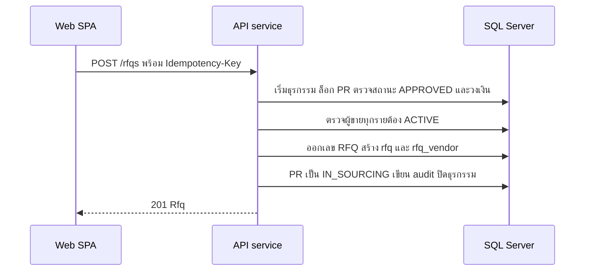

# สร้าง RFQ และบันทึกใบเสนอราคา

<!-- table: ลำดับการทำงานของ RFQ และใบเสนอราคา -->
| ลำดับ | operation | การทำงานภายใน | ผลลัพธ์หรือข้อผิดพลาด |
|---|---|---|---|
| 1 | `createRfq` | PR ต้องเป็น `APPROVED` | อื่น `409` `ERR-STATE-002` |
| 2 | `createRfq` | วงเงินรวมของ PR ต้องเกิน 5,000 บาท (BR-01 ใช้ซื้อตรงแทน) | ไม่เกิน `422` `ERR-RFQ-006` |
| 3 | `createRfq` | `vendorIds` ไม่ซ้ำและอย่างน้อย 3 ราย (BR-02) และ `dueAt` ต้องอยู่ในอนาคต | น้อยกว่า 3 `422` `ERR-RFQ-001`; วันที่ผิด `422` `ERR-VAL-001` |
| 4 | `createRfq` | ผู้ขายทุกรายต้องมีอยู่และ `ACTIVE` (BR-11) | `422` `ERR-VND-002` |
| 5 | `createRfq` | ออกเลข `RFQ-YYYY-NNNNN` insert `rfq` สถานะ `OPEN` และ `rfq_vendor` ย้าย PR เป็น `IN_SOURCING` เขียน audit | `201` |
| 6 | `getRfq` | อ่าน RFQ พร้อมเลขที่และหัวข้อของ PR รายการของ PR และผู้ขายที่เชิญ | `404` `ERR-NF-001` เมื่อไม่พบ |
| 7 | `recordQuotation` | RFQ ต้องเป็น `OPEN` และเวลาปัจจุบัน (UTC) ไม่เกิน `due_at` | `409` `ERR-RFQ-003` |
| 8 | `recordQuotation` | ผู้ขายต้องอยู่ใน `rfq_vendor` ของ RFQ นี้ (BR-07) | `422` `ERR-RFQ-002` |
| 9 | `recordQuotation` | `items` ต้องครอบคลุมทุกรายการของ PR ไม่ซ้ำ ราคารวม = ผลรวมของ ปัดเศษ 2 ตำแหน่ง (จำนวนของ PR × ราคาต่อหน่วยที่เสนอ) | ไม่ครบ `422` `ERR-VAL-001` |
| 10 | `recordQuotation` | ในธุรกรรมเดียว ตั้ง `is_active` เป็น 0 ให้ฉบับเดิมของผู้ขายรายนี้ (BR-08 เก็บประวัติ) แล้ว insert ฉบับใหม่ `is_active` เป็น 1 ดัชนีเฉพาะ `ux_quotation_active` ป้องกันสองฉบับพร้อมกัน | `201` |
