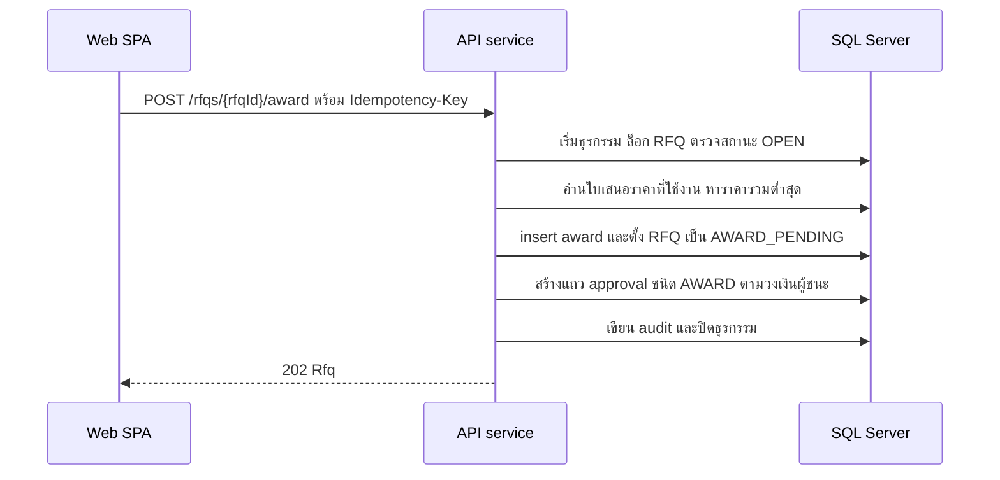

# เทียบราคาและเสนอผลเลือกผู้ชนะ

<!-- table: ลำดับการทำงานของการเทียบราคาและเสนอผล -->
| ลำดับ | operation | การทำงานภายใน | ผลลัพธ์หรือข้อผิดพลาด |
|---|---|---|---|
| 1 | `getQuotationComparison` | อ่านใบเสนอราคาที่ `is_active` เป็น 1 ของ RFQ พร้อมราคาต่อหน่วยต่อรายการและชื่อผู้ขาย เรียงตาม `quotation_id` | `404` `ERR-NF-001` เมื่อไม่พบ RFQ |
| 2 | `getQuotationComparison` | `lowestQuotationId` คือใบเสนอราคาที่ราคารวมต่ำสุด ถ้าเท่ากันเลือก `quotation_id` ที่น้อยกว่า; เป็น null เมื่อยังไม่มีใบเสนอราคา | ใช้ค่านี้ตัดสินกฎเหตุผลในลำดับที่ 5 |
| 3 | `awardRfq` | RFQ ต้องเป็น `OPEN` | อื่น `409` `ERR-STATE-001` |
| 4 | `awardRfq` | ต้องมีใบเสนอราคาที่ใช้งานอย่างน้อย 2 ราย (BR-02) และ `quotationId` ต้องเป็นหนึ่งในนั้น | `422` `ERR-RFQ-005` |
| 5 | `awardRfq` | ถ้า `quotationId` ไม่ใช่ `lowestQuotationId` ต้องมี `reason` อย่างน้อย 20 ตัวอักษร (BR-06) | `422` `ERR-RFQ-004` |
| 6 | `awardRfq` | insert `award` ตั้ง RFQ เป็น `AWARD_PENDING` | ผู้เสนอผล (`awarded_by`) คือผู้เรียก |
| 7 | `awardRfq` | สร้างแถว `approval` ชนิด `AWARD` (`doc_id` คือ `rfq_id` ของ RFQ นี้): ราคารวมผู้ชนะเกิน 200,000 บาทขั้นเดียว `COMMITTEE` นอกนั้นขั้นเดียว `PROCUREMENT_HEAD` (BR-05) | ผู้เสนอผลอนุมัติเองไม่ได้ (BR-04 ตรวจตอนตัดสิน ดู V-04) |
| 8 | `awardRfq` | เขียน `audit_log` (`AWARD`) แล้วตอบ `202` | เมื่ออนุมัติครบ RFQ เป็น `AWARDED`; เมื่อปฏิเสธ RFQ กลับ `OPEN` และลบแถว `award` (ประวัติอยู่ใน `audit_log`) |
