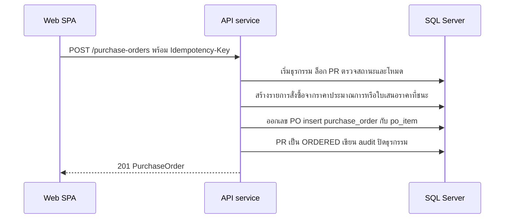

# สร้างและออกใบสั่งซื้อ

<!-- table: ลำดับการทำงานของใบสั่งซื้อ -->
| ลำดับ | operation | การทำงานภายใน | ผลลัพธ์หรือข้อผิดพลาด |
|---|---|---|---|
| 1 | `createPurchaseOrder` | โหมดซื้อตรง (ไม่ส่ง `rfqId`): PR ต้องมีอยู่ (ไม่พบ `422` `ERR-VAL-001` ที่ `prId`) และเป็น `APPROVED` และวงเงินไม่เกิน 5,000 บาท (BR-01) ต้องระบุ `vendorId` | PR ยังไม่อนุมัติ `409` `ERR-STATE-002`; เกินวงเงิน `422` `ERR-PO-001` |
| 2 | `createPurchaseOrder` | โหมดจากผลประกวด (ส่ง `rfqId`): RFQ ต้องเป็น `AWARDED` และเป็นของ PR นี้ ผู้ขายคือผู้ชนะ ไม่รับ `vendorId` จาก client | RFQ ยังไม่ `AWARDED` `409` `ERR-STATE-001` |
| 3 | `createPurchaseOrder` | ผู้ขายต้อง `ACTIVE` (BR-11) | `422` `ERR-VND-002` |
| 4 | `createPurchaseOrder` | รายการสั่งซื้อ: ซื้อตรงใช้จำนวนและราคาประมาณการของ PR; จากผลประกวดใช้จำนวนของ PR และราคาต่อหน่วยจาก `quotation_item` ของใบเสนอราคาที่ชนะ มูลค่ารวม = ผลรวมของ ปัดเศษ 2 ตำแหน่ง (จำนวน × ราคา) ซื้อตรงต้องไม่เกินวงเงิน PR (BR-09) | `po_item` ผูกกับ `pr_item` |
| 5 | `createPurchaseOrder` | ออกเลข `PO-YYYY-NNNNN` (NFR-04) insert `purchase_order` สถานะ `DRAFT` ย้าย PR เป็น `ORDERED` เขียน audit | `201` |
| 6 | `getPurchaseOrder` | อ่าน PO พร้อมรายการ ชื่อผู้ขาย รับสะสมต่อรายการ (ผลรวม `qty_received` จาก `gr_item`) และคงเหลือ = สั่ง ลบ รับสะสม | `404` `ERR-NF-001` เมื่อไม่พบ |
| 7 | `issuePurchaseOrder` | PO ต้องเป็น `DRAFT` ผู้ขายต้องยัง `ACTIVE` ตั้ง `ISSUED` และ `issued_at` เขียน audit (`ISSUE`) | สถานะอื่น `409` `ERR-STATE-001`; ผู้ขายถูกระงับ `422` `ERR-VND-002` |
