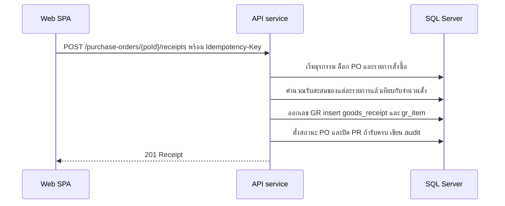

# บันทึกรับของ

<!-- table: ลำดับการทำงานของการรับของ -->
| ลำดับ | การทำงานภายใน | ผลลัพธ์หรือข้อผิดพลาด |
|---|---|---|
| 1 | PO ต้องเป็น `ISSUED` หรือ `PARTIALLY_RECEIVED` | อื่น `409` `ERR-STATE-001` |
| 2 | ทุก `poItemId` ต้องเป็นรายการของ PO นี้ ไม่ซ้ำ และมีอย่างน้อยหนึ่งรายการที่ `qtyReceived` มากกว่า 0 | `422` `ERR-VAL-001` |
| 3 | ล็อกแถว PO ไว้จนจบธุรกรรม เพื่อไม่ให้การรับของสองรายการพร้อมกันนับรับสะสมซ้ำ | การรับพร้อมกันรายการที่สองรอคิว |
| 4 | รับสะสมใหม่ = ผลรวม `qty_received` เดิมของรายการ + `qtyReceived` ที่ส่งมา ต้องไม่เกินจำนวนสั่ง จำนวนที่ปฏิเสธ (`qtyRejected`) ไม่นับเป็นรับ (BR-10) | เกิน `422` `ERR-GR-001` ทั้งใบ ไม่บันทึกบางรายการ |
| 5 | ออกเลข `GR-YYYY-NNNNN` (NFR-04) insert `goods_receipt` (`received_by` คือผู้เรียก) และ `gr_item` | `201` พร้อมเลขที่ใบรับของ |
| 6 | ทุกรายการรับสะสมเท่ากับจำนวนสั่ง: PO เป็น `RECEIVED` และ PR เป็น `CLOSED`; นอกนั้น PO เป็น `PARTIALLY_RECEIVED` | `poStatus` ใน response เป็นสถานะใหม่ |
| 7 | เขียน `audit_log` (`RECEIVE`) ในธุรกรรมเดียวกัน | |
