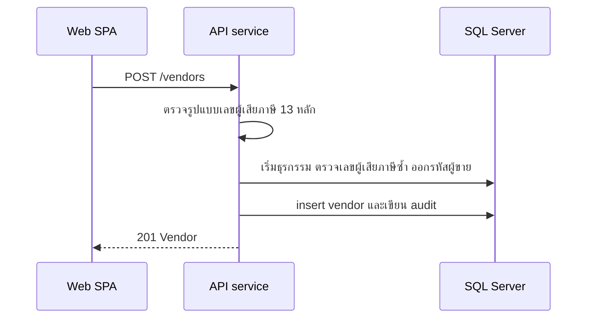

# จัดการทะเบียนผู้ขาย

<!-- table: ลำดับการทำงานของทะเบียนผู้ขาย -->
| ลำดับ | operation | การทำงานภายใน | ผลลัพธ์หรือข้อผิดพลาด |
|---|---|---|---|
| 1 | `listVendors` | ค้น `q` กับชื่อ รหัสผู้ขาย และเลขผู้เสียภาษี (ตรงบางส่วน) กรองด้วย `status` เรียงตามรหัส | ไม่มีผลตรงตอบ `200` รายการว่าง |
| 2 | `createVendor` | `taxId` ต้องเป็นตัวเลข 13 หลัก | ผิดรูปแบบ `422` `ERR-VAL-001` |
| 3 | `createVendor` | `taxId` ต้องไม่ซ้ำ (ดัชนีเฉพาะที่ฐานข้อมูลเป็นตัวตัดสินสุดท้ายเมื่อมีการสร้างพร้อมกัน) | ซ้ำ `409` `ERR-VND-001` |
| 4 | `createVendor` | ออกรหัส `V` ตามด้วยเลข 4 หลักต่อจากรหัสล่าสุด ในธุรกรรมเดียวกับการ insert สถานะเริ่มต้น `ACTIVE` เขียน audit | `201` |
| 5 | `setVendorStatus` | เฉพาะ `PROCUREMENT_HEAD` เปลี่ยน `status` เป็น `ACTIVE` หรือ `SUSPENDED` เขียน audit (`entity` เป็น `VENDOR`) โดยเก็บ `reason` ใน `detail` | ไม่พบผู้ขาย `404` `ERR-NF-001` |
| 6 | `setVendorStatus` | การระงับมีผลกับการเชิญและการออก PO ครั้งต่อไปเท่านั้น (BR-11) RFQ และ PO ที่ออกไปแล้วไม่ถูกเปลี่ยน | |
