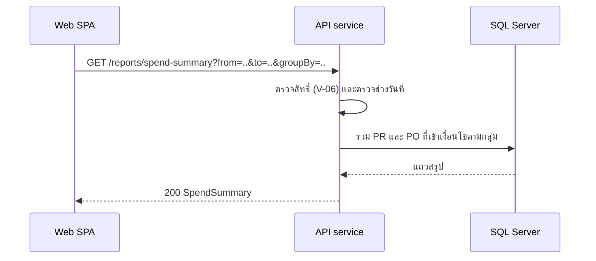

# รายงานสรุปการจัดซื้อและ audit trail

<!-- table: สูตรและลำดับการทำงานของรายงานและ audit trail -->
| ลำดับ | operation | การทำงานภายใน | ผลลัพธ์หรือข้อผิดพลาด |
|---|---|---|---|
| 1 | `getSpendSummary` | `from` ต้องไม่เกิน `to` | ผิด `422` `ERR-VAL-001` |
| 2 | `getSpendSummary` | PR ที่นับ: `created_at` (แปลงเป็นปฏิทิน Asia/Bangkok) อยู่ในช่วง `from`–`to` รวมวันสุดท้าย สถานะไม่ใช่ `DRAFT` หรือ `CANCELLED` และมี PO ที่ไม่ใช่ `DRAFT` หรือ `CANCELLED` อย่างน้อยหนึ่งใบ | PR ที่ยังไม่มี PO ไม่อยู่ในรายงาน |
| 3 | `getSpendSummary` | กลุ่มตาม `groupBy` (ไม่ส่งใช้ `department`): `department` คือหน่วยงานของ PR `vendor` คือผู้ขายของ PO `month` คือเดือน `YYYY-MM` ของ `created_at` ของ PR | เรียงตามชื่อกลุ่ม |
| 4 | `getSpendSummary` | `prCount` = จำนวน PR ไม่ซ้ำในกลุ่ม; `poCount` = จำนวน PO; `estimatedTotal` = ผลรวมวงเงินประมาณการของ PR ไม่ซ้ำในกลุ่ม (นับ PR ละหนึ่งครั้ง); `orderedTotal` = ผลรวมมูลค่า PO; `savingVsEstimate` = `estimatedTotal` ลบ `orderedTotal` | ค่าติดลบได้เมื่อสั่งเกินประมาณการ |
| 5 | `listAuditLogs` | เฉพาะ `ADMIN` อ่าน `audit_log` ตาม `entity` และ `entityId` เรียงตามเวลาจากเก่าไปใหม่ ตารางนี้รับเฉพาะ INSERT (NFR-02) | ไม่มีเหตุการณ์ตอบรายการว่าง |
