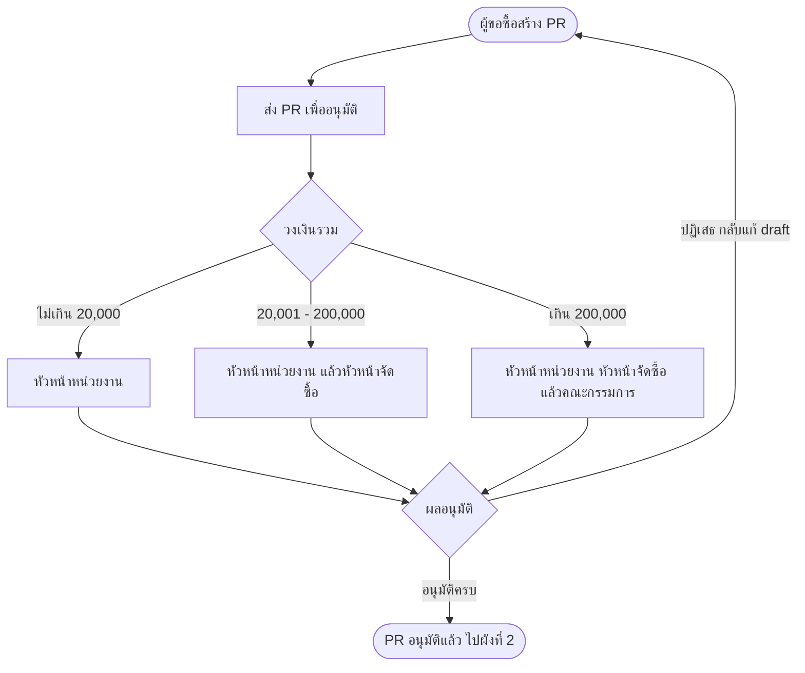
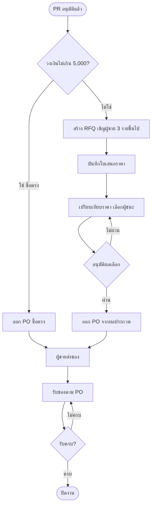
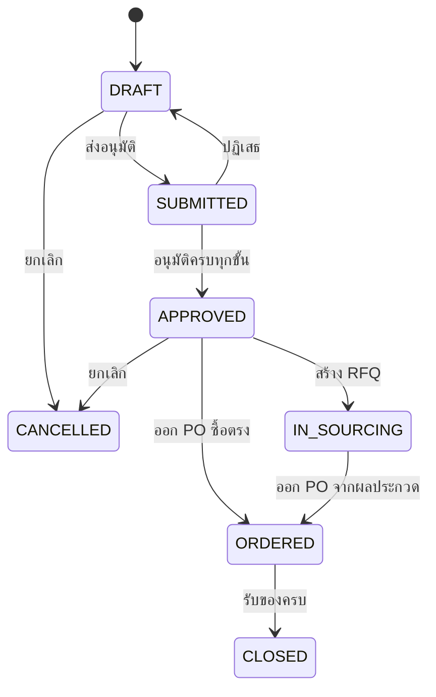
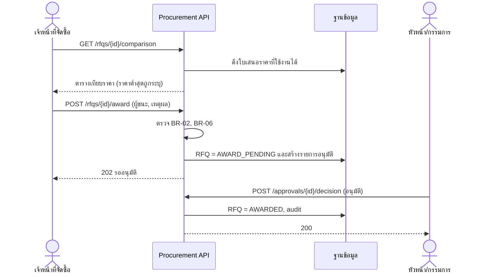

# กระบวนการธุรกิจและ Use Case

## 1. กระบวนการจัดซื้อภาพรวม

ผังที่ 1: จากการขอซื้อถึงผลอนุมัติ

ผังที่ 2: จากการจัดหาถึงปิดงาน

## 2. สถานะเอกสาร

### 2.1 ใบขอซื้อ (PR)

### 2.2 RFQ และ PO

| เอกสาร | สถานะ (ตามลำดับ) | หมายเหตุ |
|---|---|---|
| RFQ | `OPEN` → `AWARD_PENDING` → `AWARDED` | `AWARD_PENDING` คือเลือกผู้ชนะแล้วรออนุมัติผล; ถ้าไม่อนุมัติกลับเป็น `OPEN` |
| PO | `DRAFT` → `ISSUED` → `PARTIALLY_RECEIVED` → `RECEIVED` | ยกเลิกได้ (`CANCELLED`) เฉพาะก่อนมีการรับของ |

## 3. Use Case

| รหัส | ชื่อ Use Case | ผู้ใช้ | FR |
|---|---|---|---|
| UC-01 | สร้างและแก้ไขใบขอซื้อ | REQUESTER | FR-01, FR-02, FR-14 |
| UC-02 | ส่งใบขอซื้อเพื่ออนุมัติ | REQUESTER | FR-03 |
| UC-03 | อนุมัติหรือปฏิเสธใบขอซื้อ | DEPT_APPROVER, PROCUREMENT_HEAD, COMMITTEE | FR-04, FR-13 |
| UC-04 | ขอใบเสนอราคาและบันทึกใบเสนอราคา | PROCUREMENT | FR-05, FR-06, FR-14 |
| UC-05 | เปรียบเทียบราคาและเลือกผู้ชนะ | PROCUREMENT, PROCUREMENT_HEAD, COMMITTEE | FR-07, FR-08, FR-13 |
| UC-06 | ออกใบสั่งซื้อ | PROCUREMENT | FR-09, FR-14 |
| UC-07 | รับของตามใบสั่งซื้อ | RECEIVER | FR-10, FR-14 |
| UC-08 | จัดการทะเบียนผู้ขาย | PROCUREMENT | FR-11 |
| UC-09 | ดูรายงานสรุปการจัดซื้อ | PROCUREMENT_HEAD, ADMIN | FR-12 |
| UC-10 | ตรวจ audit trail | ADMIN | FR-13 |

### 3.1 UC-03 อนุมัติหรือปฏิเสธใบขอซื้อ (ตัวอย่างรายละเอียด)

| หัวข้อ | รายละเอียด |
|---|---|
| เงื่อนไขก่อน | PR สถานะ `SUBMITTED` และผู้ใช้เป็นผู้อนุมัติขั้นปัจจุบัน |
| Main flow | 1) เปิดกล่องอนุมัติ เห็นเฉพาะรายการที่ถึงขั้นของตน 2) เปิดดูรายละเอียดและวงเงิน 3) เลือก "อนุมัติ" 4) ระบบบันทึกผล ตรวจว่าเป็นขั้นสุดท้ายหรือไม่ 5) ถ้าไม่ใช่ ส่งต่อขั้นถัดไป ถ้าใช่ เปลี่ยนเป็น `APPROVED` 6) บันทึก audit |
| Alt flow A | เลือก "ปฏิเสธ" ต้องระบุเหตุผล ระบบเปลี่ยน PR เป็น `DRAFT` และแจ้งผู้ขอซื้อ |
| Exception | ผู้อนุมัติคือผู้ขอซื้อ: ปฏิเสธการทำรายการ (BR-04, `ERR-SOD-001`) ผู้อื่นตัดสินไปแล้วในขั้นเดียวกัน: `ERR-STATE-001` |
| เงื่อนไขหลัง | บันทึกผู้ตัดสิน เวลา และความเห็นใน `approval` และ `audit_log` |

### 3.2 UC-05 เปรียบเทียบราคาและเลือกผู้ชนะ (ลำดับการทำงาน)

> หมายเหตุ: การอนุมัติ PR และการอนุมัติผลเลือกผู้ชนะใช้ endpoint กลางเดียวกัน (`/approvals`) แยกชนิดงานด้วยฟิลด์ `docType` (ดูเอกสาร API)
