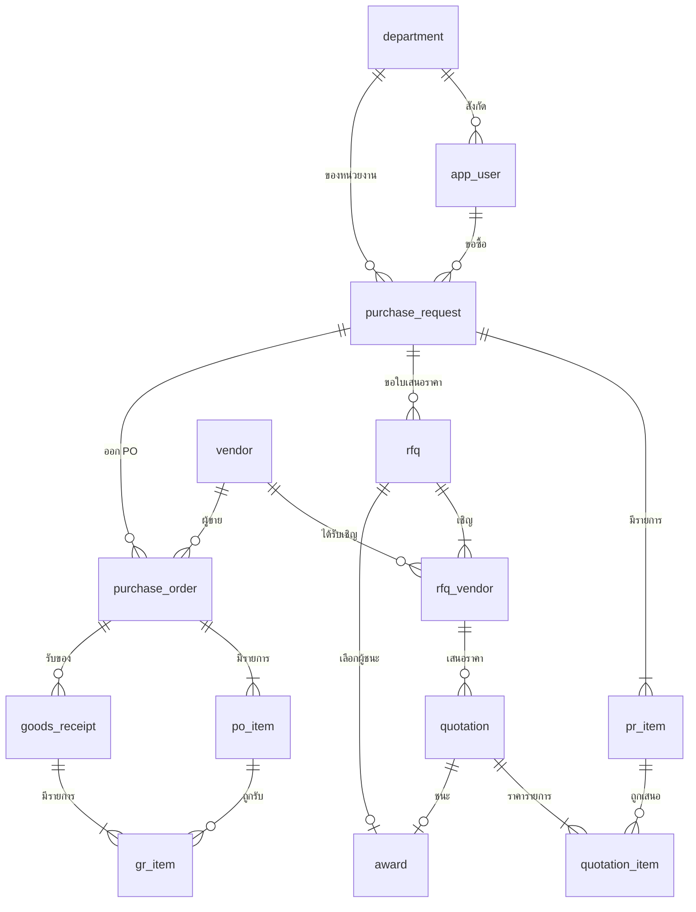

# การออกแบบข้อมูล (Data Model)

## 1. แผนภาพความสัมพันธ์ (ER Diagram)

ตาราง `approval`, `audit_log` และ `doc_sequence` ไม่ได้วาดความสัมพันธ์ เพราะอ้างเอกสารหลายชนิด (polymorphic) ตามเหตุผลในหัวข้อ 3

## 2. สรุปตารางและหน้าที่

| ตาราง | หน้าที่ | FR ที่รองรับ |
|---|---|---|
| `department`, `app_user` | หน่วยงานและผู้ใช้พร้อมบทบาท (รับข้อมูลจาก SSO) | FR-02, FR-04 |
| `purchase_request`, `pr_item` | ใบขอซื้อและรายการ | FR-01, FR-02, FR-03 |
| `approval` | สายอนุมัติและผลตัดสินทีละขั้น ทั้ง PR และผลเลือกผู้ชนะ | FR-04, FR-08 |
| `rfq`, `rfq_vendor` | ใบขอเสนอราคาและผู้ขายที่ได้รับเชิญ | FR-05 |
| `quotation`, `quotation_item` | ใบเสนอราคาและราคารายการ | FR-06, FR-07 |
| `award` | ผลเลือกผู้ชนะพร้อมเหตุผล | FR-08 |
| `purchase_order`, `po_item` | ใบสั่งซื้อและรายการ | FR-09 |
| `goods_receipt`, `gr_item` | การรับของและจำนวนที่ปฏิเสธ | FR-10 |
| `vendor` | ทะเบียนผู้ขาย | FR-11 |
| `audit_log` | บันทึกเหตุการณ์ (เพิ่มอย่างเดียว) | FR-13 |
| `doc_sequence` | ตัวนับเลขเอกสารแยกตามชนิดและปี | FR-14 |

พจนานุกรมข้อมูลรายคอลัมน์อยู่ในเอกสาร 03a (สร้างอัตโนมัติจาก `sql/schema.sql`)

## 3. การตัดสินใจออกแบบ (Design Decisions)

| หัวข้อ | การตัดสินใจ | เหตุผล |
|---|---|---|
| สายอนุมัติ | ตาราง `approval` ตารางเดียว เก็บทีละขั้น (`step_no`, `required_role`) ใช้ทั้ง PR และผลเลือกผู้ชนะผ่าน `doc_type` | สายอนุมัติเป็นข้อมูลที่ระบบสร้างตอนส่ง ไม่ใช่โครงตายตัว ถ้าเกณฑ์วงเงินเปลี่ยน ไม่ต้องแก้โครงตาราง; ยอมแลกการไม่มี foreign key ไปยังเอกสารต้นทาง จึงบังคับด้วยตรรกะใน service และ unique `(doc_type, doc_id, step_no)` |
| ผู้ขายต้องถูกเชิญก่อนเสนอราคา | `quotation` อ้าง foreign key แบบรวม `(rfq_id, vendor_id)` ไปยัง `rfq_vendor` | ฐานข้อมูลบังคับ BR-07 เอง ไม่พึ่งแค่โค้ดแอป |
| ใบเสนอราคาที่ใช้งานได้ฉบับเดียว | unique index แบบมีเงื่อนไข `WHERE is_active = 1` | BR-08: บันทึกซ้ำให้ฉบับเก่า `is_active = 0` เก็บประวัติครบ |
| ล็อกการแก้ซ้อน | `row_version` (ROWVERSION) ใน `purchase_request` | ผู้ใช้สองคนแก้ draft เดียวกัน คนหลังได้ conflict แทนที่จะเขียนทับเงียบๆ |
| เลขเอกสาร | `doc_sequence` + `usp_next_doc_no` ล็อกแถวเดียวต่อ (ชนิด, ปี) | NFR-04: ไม่ใช้ `MAX()+1` ซึ่งซ้ำเมื่อออกพร้อมกัน; ยอมรับว่าเลขอาจข้ามเมื่อธุรกรรมของผู้เรียกถูก rollback |
| audit | `audit_log` เพิ่มอย่างเดียว และ `DENY UPDATE, DELETE` | NFR-02 |
| เวลา | `DATETIME2(0)` เก็บ UTC | NFR-06 แปลงเป็น พ.ศ. ที่หน้าจอ |
| เงิน | `DECIMAL(14,2)` | หลีกเลี่ยงความคลาดเคลื่อนของทศนิยมลอย |

## 4. ดัชนีหลักและแผนรองรับ NFR-01

| ดัชนี | รองรับคำค้น |
|---|---|
| `ix_pr_status_created (status, created_at DESC) INCLUDE (pr_no, department_id, total_estimated)` | หน้ารายการ PR กรองตามสถานะ เรียงล่าสุด เป็น covering index ไม่ต้อง key lookup |
| `ix_pr_requester (requester_id, created_at DESC)` | "PR ของฉัน" |
| `ix_approval_pending (required_role, decision) INCLUDE (...)` | กล่องอนุมัติของแต่ละบทบาท |
| `ix_audit_entity (entity, entity_id, created_at)` | ไล่ประวัติของเอกสารหนึ่งใบ |

หน้ารายการใช้ pagination แบบ keyset (ตามฟิลด์ `created_at, pr_id`) เพื่อให้เวลาตอบไม่โตตามจำนวนหน้า ข้อนี้ยังไม่ได้วัดจริงบน SQL Server ในรุ่นนี้ (ดูเอกสารทดสอบหัวข้อข้อจำกัด)
