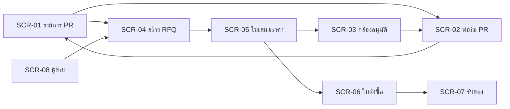

# ข้อกำหนดหน้าจอ (Screen Specification)

## 1. ภาพรวมหน้าจอ

| รหัส | ชื่อหน้าจอ | บทบาท | Use Case | FR | API (operationId) |
|---|---|---|---|---|---|
| SCR-01 | รายการใบขอซื้อ | ทุกบทบาท (ตามสิทธิ์) | UC-01 | FR-02 | listPurchaseRequests |
| SCR-02 | แบบฟอร์มใบขอซื้อ | REQUESTER | UC-01, UC-02 | FR-01, FR-03 | createPurchaseRequest, getPurchaseRequest, updatePurchaseRequest, submitPurchaseRequest |
| SCR-03 | กล่องอนุมัติ | DEPT_APPROVER, PROCUREMENT_HEAD, COMMITTEE | UC-03, UC-05 | FR-04, FR-08 | listMyApprovals, decideApproval |
| SCR-04 | สร้าง RFQ และเชิญผู้ขาย | PROCUREMENT | UC-04 | FR-05 | createRfq, listVendors |
| SCR-05 | บันทึกและเปรียบเทียบใบเสนอราคา | PROCUREMENT | UC-04, UC-05 | FR-06, FR-07, FR-08 | recordQuotation, getQuotationComparison, awardRfq |
| SCR-06 | ใบสั่งซื้อ | PROCUREMENT | UC-06 | FR-09 | createPurchaseOrder, issuePurchaseOrder |
| SCR-07 | บันทึกการรับของ | RECEIVER | UC-07 | FR-10 | recordGoodsReceipt |
| SCR-08 | ทะเบียนผู้ขาย | PROCUREMENT, PROCUREMENT_HEAD | UC-08 | FR-11 | listVendors, createVendor, setVendorStatus |
| SCR-09 | รายงานสรุปการจัดซื้อ | PROCUREMENT_HEAD, ADMIN | UC-09 | FR-12 | getSpendSummary |
| SCR-10 | Audit trail | ADMIN | UC-10 | FR-13 | listAuditLogs |

## 2. ผังการนำทาง

## 3. รายละเอียดฟิลด์ (ตัวอย่างหน้าจอหลัก)

### 3.1 SCR-02 แบบฟอร์มใบขอซื้อ

| ฟิลด์ | ชนิด | บังคับ | กติกา | ข้อความผิดพลาด |
|---|---|---|---|---|
| หัวข้อ | ข้อความ | ใช่ | 1–200 ตัวอักษร | กรุณาระบุหัวข้อ |
| เหตุผลความจำเป็น | ข้อความหลายบรรทัด | ใช่ | 1–1,000 ตัวอักษร | กรุณาระบุเหตุผล |
| วันที่ต้องการใช้ | วันที่ (แสดง พ.ศ.) | ใช่ | ไม่ก่อนวันนี้ | วันที่ต้องการใช้ต้องไม่ก่อนวันนี้ |
| รายการ: รายละเอียด | ข้อความ | ใช่ | 1–300 ตัวอักษร | กรุณาระบุรายการ |
| รายการ: จำนวน | ตัวเลข | ใช่ | มากกว่า 0 ทศนิยมไม่เกิน 3 ตำแหน่ง | จำนวนต้องมากกว่า 0 |
| รายการ: หน่วยนับ | ข้อความ | ใช่ | 1–30 ตัวอักษร | กรุณาระบุหน่วยนับ |
| รายการ: ราคาต่อหน่วยประมาณการ | ตัวเลขเงิน | ใช่ | 0 ขึ้นไป ทศนิยม 2 ตำแหน่ง | ราคาต้องไม่ติดลบ |
| วงเงินรวม | ตัวเลขเงิน | – (คำนวณ) | ผลรวม จำนวน × ราคา แสดงทันทีขณะกรอก | – |
| สายอนุมัติที่จะเกิดขึ้น | ข้อความ | – (แสดง) | แสดงตาม BR-03 จากวงเงินรวมก่อนกดส่ง | – |

| ปุ่ม | เงื่อนไขที่ใช้ได้ | ผล |
|---|---|---|
| บันทึกร่าง | สถานะ DRAFT | เรียก `createPurchaseRequest` หรือ `updatePurchaseRequest` |
| ส่งอนุมัติ | สถานะ DRAFT และข้อมูลครบ | เรียก `submitPurchaseRequest` แล้วกลับ SCR-01 |
| ยกเลิก | สถานะ DRAFT | ยืนยันก่อน แล้วกลับ SCR-01 |

พฤติกรรมเมื่อ `ERR-CONC-001`: แสดงกล่องแจ้งว่ามีผู้อื่นแก้ไขแล้ว ให้โหลดข้อมูลล่าสุดแทนการเขียนทับ

### 3.2 SCR-03 กล่องอนุมัติ

| องค์ประกอบ | รายละเอียด |
|---|---|
| ตาราง | เลขที่เอกสาร, ชนิด (PR/ผลเลือกผู้ชนะ), หัวข้อ, ผู้ขอ, วงเงิน, ขั้นที่, วันที่ส่ง เรียงเก่าสุดก่อน |
| การตัดสิน | ปุ่ม "อนุมัติ" และ "ปฏิเสธ" ปฏิเสธเปิดช่องเหตุผล (บังคับ) |
| กฎแสดงผล | ซ่อนปุ่มตัดสินเมื่อผู้ใช้คือผู้ขอซื้อ (BR-04) และแสดงข้อความอธิบายแทน |
| สถานะว่าง | "ไม่มีรายการรออนุมัติ" |

### 3.3 SCR-05 บันทึกและเปรียบเทียบใบเสนอราคา

| องค์ประกอบ | รายละเอียด |
|---|---|
| ตารางเทียบราคา | แถวคือรายการ PR คอลัมน์คือผู้ขาย เซลล์คือราคาต่อหน่วย แถวสรุปราคารวมและระยะเวลาส่งมอบ ไฮไลต์ราคารวมต่ำสุด |
| เลือกผู้ชนะ | เลือกผู้ขาย 1 ราย; ถ้าไม่ใช่ต่ำสุด ช่องเหตุผลบังคับ (อย่างน้อย 20 ตัวอักษร) พร้อมตัวนับตัวอักษร |
| ปุ่ม "เสนอผล" | ใช้ได้เมื่อมีใบเสนอราคาอย่างน้อย 2 ราย (BR-02) |

## 4. กติกากลางของทุกหน้าจอ

| หัวข้อ | กติกา |
|---|---|
| วันที่ | แสดงเป็น พ.ศ. รูปแบบ `วว/ดด/พศพศ` เก็บส่งเป็น ISO 8601 |
| เงิน | คั่นหลักพัน ทศนิยม 2 ตำแหน่ง ชิดขวา หน่วยบาท |
| สถานะ | แสดงเป็นป้ายสี พร้อมข้อความ (ไม่ใช้สีอย่างเดียว) |
| ข้อผิดพลาด | แสดงข้อความภาษาไทยจาก `message` ที่ฟิลด์ที่เกี่ยวข้อง และสรุปบนหัวฟอร์ม |
| การเข้าถึง | ทุกฟิลด์มี label; ควบคุมด้วยแป้นพิมพ์ได้; อัตราส่วนสีตัวอักษรอย่างน้อย 4.5:1 |
| การส่งซ้ำ | ปุ่มที่เรียก API เปลี่ยนสถานะปิดการกดระหว่างรอ และสร้าง `Idempotency-Key` ใหม่ต่อการกระทำหนึ่งครั้ง |
